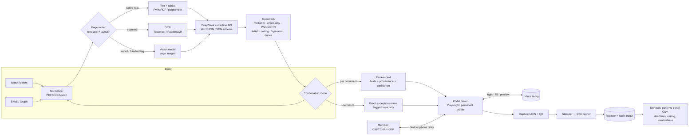

# UDIN Autopilot — Ambition Roadmap (L0 → L5)

**Goal:** documents in → valid UDINs out → audit-proof register, with **zero human work** in the loop.
**Prepared:** 28 October 2026 · **Supersedes:** the autonomy assumptions in [ROADMAP.md](ROADMAP.md) (the compliance foundation there still applies).

---

## 0. One-page answer

- **What is achievable in ~20 weeks:** **L4 — lights-out operations with one gesture.** The firm runs a nightly pipeline that ingests signed documents, extracts and validates every portal field, batches them, pre-fills the portal, and pauses only for the member's **single OTP gesture per batch** (one per 300 certificates, one per 10 tax-audit UDINs). The member never opens the portal, never keys a field, never reviews routine documents. Median active human time: **≤ 60 seconds/day**.
- **The pipeline (confirmed 28 Oct 2026):** **DeepSeek API extraction on both modalities** — native text after local parsing/OCR, and page **vision** for scans/layout/handwriting — producing a strict UDIN JSON payload, then **both confirmation modes** (per document and per batch) before the member's OTP; portal fill, capture, stamp, register. Full spec: [docs/PIPELINE.md](docs/PIPELINE.md).
- **What is not achievable by engineering alone:** **L5 — literally zero humans.** ICAI's portal requires a per-member CAPTCHA + OTP, the 2026 Guidelines make UDIN the signing member's personal attestation, and firms cannot register. Intercepting OTPs or solving CAPTCHAs would be a terms-of-use breach, would undermine the attestation itself, and invites disciplinary action (including published penalties under Guidelines Ch. IX). **L5 is a rules problem, not a code problem.**
- **How we pursue L5 anyway:** a formal **ICAI-sanctioned integration** track — Guidelines §13 already contemplates MoU/API arrangements with agencies; we propose a controlled firm-level API or a pre-authorised batch model, with member-bound keys and an audit trail. Timeline: proposal in month 1, pilot by month 6–9 if accepted, production by month 12–18. If ICAI declines, **L4 is the permanent ceiling** and we say so.

**Human-touch math (per 100 UDINs):** manual ≈ 100+; assisted single-doc ≈ 100; batch autopilot ≈ **1** (certificates) / **10** (tax audit); L4 ≈ **1 per batch/day**; L5 = **0**.

---

## 1. Ambition contract

**Goal question (Altitude fork).** I read "remove humans from the equation" at two levels:

- **A — remove humans from the work:** no typing, no portal, no document handling; the signing member is present only as the statutory authenticator for the OTP. → **This is the plan below; L4 in ~20 weeks.**
- **B — remove humans entirely, including the OTP:** requires ICAI to sanction an API, delegated authentication, or a pre-authorised batch model. → **Pursued as Phase 5; blocked until ICAI agrees.**

Both are in scope; only A has an engineering path. The roadmap is built so A ships regardless of B.

**Raw material (what an expert starts from):** shipped portal bundle (9.85 MB Angular/TS DigiGov app), official FAQs and the 2026 Guidelines, the portal's own bulk templates, the firm's signed-document corpus, the portal's `List UDIN` export and e-filing validation responses, and access logs from one real member session.

**Instruments (not summaries):** the live portal (headed Playwright, role/label locators), the native Excel bulk endpoints (`/udin-config/bulk-upload/dynamic-template/download`, `/udin/udinGeneration/bulk-save`), the firm's e-filing portal validation (5 parameters), SHA-256 document ledger, a scheduled daemon with crash-safe resume, and a phone-side approval relay. Legal instrument: written opinion on delegated attestation under the CA Act and the UDIN Guidelines.

**Fields (verbs → borrowed methods):**

| Verb | Field | Method borrowed |
|---|---|---|
| Detect and extract from messy documents | Document AI / IDP | confidence-scored extraction + provenance, holdout corpus |
| Schedule unattended runs safely | Site reliability engineering | canary checks, fail-closed, idempotent batches, kill switch |
| Prove compliance to a sceptic | Audit / forensic accounting | register parity vs portal CSV, tamper-evident log, exception sampling |
| Handle the authentication boundary | Security engineering | OS keystore, device binding, no OTP persistence, threat model |
| Change the rules | Regulatory strategy | MoU/API proposal, pilot with controls, standards-body engagement |

**Axes (plain → aim):**

- **Altitude:** artifact (a roadmap) → **outcome kept true without the user**: a nightly autopilot that a partner can ignore, with a weekly exception report. → Rung 3.
- **Speed:** same portal steps, faster → **a 10× tighter loop**: batch once, not per document; one OTP per 300; season-scale throughput (~10k UDINs) instead of per-document sessions. → Rung 3.
- **Proof:** own reading → **outside judge that already exists**: the portal's own UDIN list, e-filing validation results, and bank/verifier checks. → Rung 2, aiming at 3 on pilot data.

**Contract (locks on approval).**

| Line | Content |
|---|---|
| **Judge** | Reconcile the app register against the portal's exported `List UDIN` CSV for every batch (UDIN, category, date, status), plus the e-filing portal's 5-parameter validation on a sample of ≥20 filings. Pass: **100% register parity, 0 invalidated UDINs, 0 unrecorded UDINs**. The app cannot mark its own homework. |
| **Target** | **≤1 human gesture per 300 certificate UDINs and per 10 tax-audit UDINs; ≥95% straight-through documents; median active human time ≤60 s/day; 0 invalidations.** State: **unreasonable on purpose** — no baseline has been measured and no known firm runs an UDIN autopilot. |
| **Stop line** | Three real approaches to the OTP boundary (batch, phone relay, platform/API). If the legal opinion and ICAI both foreclose a sanctioned path, **L4 is declared the permanent ceiling** and the miss is reported with the evidence. |
| **Scope** | This document is the deliverable. Implementation phases in §5 begin only on your approval; no portal automation is built in this turn. |
| **Runs** | Autopilot daemon · owner: signing member's ops lead · kill when: portal-change canary fails twice in a row, or any invalidated UDIN is detected. |

---

## 2. Three approaches, scored

| Approach | What it is | Human touches | Verdict |
|---|---|---|---|
| **Obvious** — assisted single-document generation | App pre-fills, CA solves CAPTCHA + OTP per document | ~1 per UDIN | Necessary foundation, but not ambitious enough; keeps the partner at the desk |
| **10× — batch autopilot + lights-out scheduler** | Queue documents, batch via native bulk, one OTP per batch, auto-stamp, auto-register; phone approval relay | ~1 per 300 (cert) / per 10 (tax) | **Chosen for L4.** Uses ICAI's own batch feature; legally clean because the member still OTP-authorises |
| **Dissolve** — remove the authentication step by rule change | ICAI-sanctioned API / delegated key / pre-authorised batch; no OTP at generation | **0** | **Chosen for the L5 track.** Only path to literal zero-human; cannot be engineered unilaterally |

The trap to avoid: treating OTP interception as "automation". It is the one step that makes the attestation the member's, and the 2026 Guidelines' public-disclosure power makes the downside asymmetric.

---

## 3. Autonomy ladder

| Level | Name | Human role | What runs automatically | Blocking constraint |
|---|---|---|---|---|
| **L0** | Manual | Everything | Nothing | — |
| **L1** | Assisted prep | Reviews/corrects fields, submits | Ingest, classify, extract, validate, pre-fill | CAPTCHA + OTP |
| **L2** | Assisted submit | One OTP per document | L1 + portal fill + stamp + register | OTP per UDIN |
| **L3** | Batch autopilot | One OTP per batch | Queue, batch (3–300), capture, stamp, register, revoke workflow | OTP per batch; 300/10 caps |
| **L4** | Lights-out | **One gesture/day** (phone), exception handling | Nightly schedule, drafts, batches, recovery, alerts, reconciliation | OTP presence (statutory) |
| **L5** | Zero-human | **None** | Everything, including attestation | **Requires ICAI-sanctioned API/delegation** |

**Definition of "human removed":** at L4 the human is not in the document-to-UDIN path at all; they are a 20-second authenticator. At L5 even that disappears. We will not blur the two in product copy.

---

## 4. Architecture for autonomy

**Design rules:** idempotent batches; every UDIN keyed to document SHA-256; drafts persisted before any OTP; fail closed to manual on any selector/canary mismatch; no credential, OTP or CAPTCHA automation anywhere; one vault and one profile per signing member.

**The OTP bridge (legitimate options only):** (a) desk prompt; (b) phone companion — the member receives the OTP on their own phone, types it into the companion app, which relays it over an encrypted local channel to the driver; (c) future DigiCA biometric approval if ICAI exposes one. All keep the human as the authenticator; none read SMS or email.

**4.1 Extraction stack — both modalities (confirmed 28 Oct 2026).** The app supports **native-text extraction** (PyMuPDF/pdfplumber → DeepSeek text model) and **page vision** (page images → vision model) with **OCR as both fallback and cross-check**. A per-page router picks the path; numeric fields (amounts, PAN, dates) are cross-checked across two paths and any disagreement forces human confirmation — the model never majority-votes money. DeepSeek receives a strict JSON schema (category/sub-category/form/section, act, FRN, signing date, client name, auditee PAN, opinion, preceding-year block, key-field pairs, description, MoC, s.44AB answers) and every value must be a verbatim substring of the source; enum fields may only take portal values. Default is **hybrid** (deterministic local extraction for identifiers + LLM for classification/opinion/description), with a local-model fallback for clients who refuse cloud processing. Full spec: [docs/PIPELINE.md](docs/PIPELINE.md).

---

## 5. Phased roadmap

Assumes approval at week 0; durations overlap deliberately.

### Phase 0 — Baseline, legality, and the OTP boundary (weeks 0–2)
- Measure the real baseline: time and touches for 10 manual UDINs across 4 categories (stopwatch + screen recording); record portal session/OTP behaviour.
- Legal opinion: delegated authentication under the CA Act and UDIN Guidelines 2026; ToS review of the portal.
- Capture the field dictionary, dropdowns, client-name field, register format, 44AB preliminary answers.
- **Exit:** baseline measured; written L4-is-the-legal-ceiling position; go/no-go.

### Phase 1 — Straight-through document engine (weeks 2–8)
- Connectors: watch folder, email, Drive/DMS; dedupe by hash.
- **Extraction stack (both modalities):** page router → native text (PyMuPDF/pdfplumber), OCR (Tesseract/PaddleOCR) for scans, **vision model on page images** for layout/handwriting; numeric fields cross-checked across paths.
- **DeepSeek API extraction:** two-pass (classify document type → strict UDIN JSON), JSON mode, temperature 0, page-cited provenance, verbatim-substring guard, enum-only dropdowns.
- Extractors for 8 document types (3CA/3CB+3CD, GSTR-9C, company audit, bank branch, net-worth, turnover, 15CB, funds-utilisation certificates).
- **Both confirmation modes:** per-document review for audit reports/tax audits; per-batch exception review for certificates; configurable firm policy.
- Validation: PAN/GSTIN/date/60-day/dupes, **s.44AB eligibility**, **60-audit ceiling**, category↔form consistency, e-filing 5 parameters.
- Review queue only for low confidence; high-confidence documents pre-approved by firm policy (partner configures once).
- **Exit metric:** ≥90% fields auto-filled; ≥90% documents need <3 corrections; 100 documents/day throughput.

### Phase 2 — Batch autopilot (weeks 6–14)
- Certificates: build the per-sub-category Excel template, 3–300 per batch, native bulk upload.
- Tax Audit / Audit & Assurance: 3–10 per UI batch (Aug-2026 facility), or row-by-row fill with batch OTP.
- **Confirmation before OTP (both modes):** per-document review for audit reports/tax audits; per-batch exception review for certificates — only flagged rows need attention.
- Capture all returned UDINs + QR, map back to documents, auto-stamp, auto-register.
- Revoke/regenerate runbook, still OTP-authenticated by the member.
- **Exit metric:** ≤1 touch per 100 certificate UDINs; ≤10 per 100 tax-audit UDINs; batch success ≥99%; 0 invalidations.

### Phase 3 — Lights-out scheduler (weeks 12–20)
- Nightly daemon: pick up signed documents, build batches, pre-fill and `Save Draft`, notify the member "one batch ready".
- Phone companion approval: batch summary + OTP entry; encrypted local relay; 90-second countdown with resend guard.
- Crash-safe resume; portal-change canary; manual fallback that never loses a draft.
- **Exit metric:** median active human time ≤60 s/day; 95% of batches need only the OTP gesture; zero lockouts.

### Phase 4 — Firm-scale autonomy (weeks 18–28)
- Multi-member routing (documents go to the signing member), per-member vaults/profiles, ceiling and workload dashboards, absence rota planning.
- Chaos drills: portal downtime, OTP delay, selector change, quota exhaustion, duplicate document.
- **Exit metric:** 5 partners, ~10k UDINs in a season, 0 compliance findings, MTTR <1 day.

### Phase 5 — Sanctioned zero-human (months 7–24, strategic)
- **Proposal to the ICAI UDIN Directorate:** a firm-level integration under Guidelines §13 (MoU/API), or a pre-authorised batch model where one OTP authorises generation of a declared batch later. Controls offered: member-bound key in an HSM, per-UDIN intent log, no credential sharing, ICAI audit access, revocation hooks.
- Parallel: DigiCA mobile/biometric authentication study; eSign/DSC delegation analysis; legal/ethics opinions.
- **Gates:** submit (month 1) → pilot (months 6–9) → production (12–18) or published denial with reasons.
- **If denied:** L4 remains the ceiling; the product says so honestly, and the register/audit infrastructure is already the differentiator.

---

## 6. Metrics that prove autonomy (not vibes)

| Metric | Definition | L4 target | Proof source |
|---|---|---|---|
| Human touches / 100 UDINs | OTP entries + field corrections + manual steps | ≤1 (cert), ≤10 (tax) | app event log |
| Straight-through rate | Documents needing no human field change | ≥95% | extraction audit |
| Confirmation burden | Rows a human actually reviews | exceptions only (batch); 100% high-stakes (per-doc) | review log |
| Register parity | App register vs portal CSV, row by row | 100% | portal export |
| Invalidated UDINs | e-filing 5-param failures | 0 | e-filing portal |
| Active human time | Median seconds/day | ≤60 s | screen-time log |
| Batch success | Batches completed without manual recovery | ≥99% | daemon log |
| Cycle time | Signed document → UDIN + stamp | <4 h (nightly SLA) | timestamps |
| Compliance | Revoked-without-notice, missed 60-day, ceiling breach | 0 | register audit |

---

## 7. Risks and red lines

| Risk | Mitigation |
|---|---|
| Portal change breaks selectors | Role/label locators, daily canary, fail-closed to manual, version log |
| OTP window (90 s) / 5-resend exhaustion | Pre-fill first, OTP last, countdown, hard stop before resend limit |
| Account lockout / rate limits | One attempt per batch, no parallel sessions, capped retries |
| Credential compromise (SSP = full ICAI identity) | DPAPI/Credential Manager, per-member vault, device binding, no argv/logs |
| Invalid UDIN / wrong category / ceiling breach | 44AB eligibility + ceiling + 5-param validator before OTP; human-confirmed low-confidence fields |
| LLM extraction error / hallucinated value | verbatim-substring guard, enum-only values, two-path cross-check on money, confidence thresholds, mandatory confirmation |
| Client data sent to DeepSeek cloud | hybrid minimisation by default, DPA/no-retention, per-client opt-in, local/self-hosted model fallback |
| Guidelines discipline + public disclosure | Register completeness, client communication, verifier notices, legal review |
| "Autopilot" misread as OTP interception | Product copy states the boundary; no SMS/email reading; no CAPTCHA solving |

**Red lines (never build):** OTP interception, CAPTCHA solving, credential sharing, look-alike portal UI, hidden headless login, generation without the member's personal authorisation.

---

## 8. Resourcing and budget

| Role | Commitment | Phases |
|---|---|---|
| Senior full-stack / automation engineer | 1.0 FTE | 0–4 |
| Extraction/ML engineer | 0.5 FTE | 1–2 |
| CA domain owner (partner) | 0.2 FTE | 0–4 |
| Legal counsel (CA Act / DPDP) | milestone-based | 0, 5 |
| Security reviewer | milestone-based | 2, 4 |

**Calendar:** L4 for one firm in **~20–28 weeks**; firm-scale rollout +2–4 weeks; L5 depends on ICAI, not on us.

---

## 9. First 14 days (on approval)

1. Nominate the member for the measured baseline and one observed portal session.
2. Provide 10 redacted documents across 4 categories.
3. Legal opinion commissioned; ToS captured.
4. Field dictionary v1 + selector map + 44AB/ceiling rules encoded as tests.
5. Baseline CSV published; Phase 1 starts.

---

## 10. What this changes in the existing plan

- The compliance foundation in [ROADMAP.md](ROADMAP.md) (extraction, validation, stamping order, register, security) is unchanged — it becomes Phases 1–2 here.
- The sequencing changes: **batch before single-document polish**, because batch is what removes the human from the loop.
- A new workstream exists that was not in the original plan: **the ICAI partnership track**. It is the only route to literal zero-human, and it starts in month 1, not "someday".

*Bottom line: in ~5 months a partner can stop opening the portal; in 12–24 months — only if ICAI sanctions it — the member can stop being present for the OTP too. Anything that claims to remove the OTP without that sanction is not automation; it is a disciplinary risk.*
