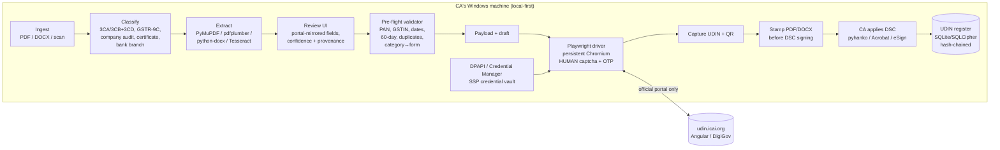

# UDIN Generator — Build Roadmap & Architecture

**Prepared:** 27 October 2026 · **For:** Dhruv Dua & Co · **Basis:** [research/00-executive-summary.md](research/00-executive-summary.md) + four sourced research streams
**Status:** plan for approval. No portal automation is built or attempted yet.

---

## 0. Product definition (what we are building)

> **A local, CA-operated UDIN workbench for Windows:** drop a PDF/Word document → it reads the document, proposes every field the ICAI UDIN portal needs, validates them, lets the signing CA confirm, drives the **official** `udin.icai.org` portal in a visible browser, **pauses for the CA's CAPTCHA and OTP**, captures the 18-digit UDIN + QR, stamps it on the document in the correct signing order, and keeps a firm-grade UDIN register with deadlines and revocation history.

**Positioning:** the app is a **member-operated helper**. It never generates a UDIN the member has not personally OTP-authorised, never solves a CAPTCHA, never reads SMS/email OTPs, and never reimplements the portal.

### Non-goals (lock these now)

- ❌ Fully unattended / headless / server-side UDIN generation (feasibility ≈ 1/10; CAPTCHA + mandatory OTP + no API).
- ❌ OTP interception (SMS/email/notification), CAPTCHA solving, credential sharing across staff, look-alike portal UI.
- ❌ Storing client documents in the cloud by default; sending PAN/financials to a cloud LLM without explicit opt-in.
- ❌ Touching `preprodudin.icai.org` or any internal host observed in the portal bundle.
- ❌ "UDIN API provider" integrations — no legitimate member API exists; ICAI warns against replica interfaces.

---

## 1. Architecture

### Component and stack decisions

| Layer | Choice | Why |
|---|---|---|
| Language/core | **Python 3.12+** | PyMuPDF/python-docx/OCR/Playwright all first-class; one language for extraction + automation |
| UI | Local web UI (FastAPI + React/HTMX) wrapped with **pywebview**; Tauri/Electron shell only after the flow is proven | Fast iteration; visible browser separately via Playwright |
| Browser automation | **Playwright + Chromium persistent profile**, always headed, role/label locators | Portal is Angular SPA; hashed bundles break CSS/XPath; human gates are mandatory |
| Extraction | PyMuPDF (text/geometry/stamping), pdfplumber (tables), python-docx (Word), Tesseract 300 dpi; PaddleOCR only for table-heavy scans | Offline, no client data leaves the machine |
| Signing | pyhanko (or hand-off to Acrobat/eSign) | Signature must cover the stamped bytes |
| Storage | SQLite + **SQLCipher**, or AES-256-GCM encrypted store with DPAPI-wrapped key | Local-first; register is the system of record |
| Secrets | DPAPI user-scoped / Windows Credential Manager; optional "don't remember" default | SSP password = full ICAI identity; never plaintext/argv/logs |
| Packaging | PyInstaller + signed installer (Inno Setup), auto-update optional | CAs need double-click install; code signing builds trust |
| Telemetry | Off by default; anonymised, redacted, opt-in | DPDP + confidentiality posture |

### Data model (minimum)

`Member (MRN, name, PAN, vault)` → `Firm (FRN, name)` → `Client (name, PAN, GSTIN?)` → `DocumentBundle (hash, pages, source)` → `DocumentPart (page range, doc type)` → `UDINRecord` (`udin, category, sub_type, form_section, act, frn, signing_date, pan_of_auditee, opinion, preceding_audit, key_fields[], description, remarks, moc, status, generated_at, revoke_deadline, regenerated_from`) → `VerificationEvent` → `AuditLog` (append-only, hash-chained).

**Cardinality:** a bundle can require **N UDINs** (e.g. 3CA/3CD + a certificate in one PDF). Model it that way from day one.

---

## 2. Phased plan

| Phase | Duration | Outcome | Exit criteria |
|---|---|---|---|
| **0. Reality capture & decisions** | 3–5 days | Field dictionary, selector map, terms review, locked scope | Written go/no-go + signed-off scope |
| **1. Document → payload engine** | 2–3 weeks | Extract, classify, review, validate, export payload | Zero wrong mandatory values un-flagged on 20 test docs |
| **2. Assisted portal automation** | 2–3 weeks | Playwright fills form; human CAPTCHA/OTP; UDIN captured | 10 consecutive end-to-end UDINs, 0 mis-submitted fields |
| **3. Stamping, signing order, register** | 1–2 weeks | Correct stamp→sign order, hash archive, deadlines, revoke | Signed stamped PDF verifies; signed inputs blocked |
| **4. Bulk + hardening + pilot** | 2 weeks | Excel bulk path, installer, backups, regression fixtures | 50-certificate batch; 5-day crash-free pilot |
| **5. Firm rollout / productisation** | ongoing | Multi-member vaults, roles, SOPs, support | Partners operating without dev support |

**Estimate:** ~8–12 weeks for v1 with **1 senior developer + part-time CA domain tester**. Compressible to ~6–8 weeks if v1 is limited to **Certificates + GST/Tax Audit**.

### Phase 0 — Reality capture & decisions (do not skip)

The single largest evidence gap is behind login: exact DOM, dropdowns, OTP behaviour, session timeout. This phase closes it **manually and legitimately**.

1. **Read the UDIN/DigiCA terms of use** in a browser; record the exact clause on automated access (open question today).
2. **One real member session (human-performed):** capture login form DOM, CAPTCHA behaviour, OTP behaviour (login + generation), idle timeout, the full **40-item certificate dropdown**, GST/Tax form list, Audit & Assurance type/act lists, mandatory-field matrix, bulk template columns, error messages.
3. Confirm whether OTP is per-session or per-UDIN; lockout/rate-limit behaviour; quota semantics.
4. **Legal/positioning review:** member-operated helper vs service acting for the member; DPDP/confidentiality note; ICAI disciplinary framing.
5. Lock v1 scope: document types, categories, bulk, pricing/internal-only.
6. Confirm **Guidelines 2026 commencement**, whether a **register format** has been prescribed (Guidelines §18(vi)), and whether the DigiCa form has a **client-name** field (Guidelines §8(b)).

**Deliverable:** `docs/portal-field-dictionary-v1.md` + selector map + terms note + signed scope.

### Phase 1 — Document → payload engine

- Ingest PDF, DOCX, scanned PDF; batch cards; encrypted/unsupported handling.
- Classifier for v1: **Form 3CA/3CB + 3CD, GSTR-9C, company statutory audit report, net-worth/turnover/15CB certificates, bank-branch audit**.
- Extractor registry with per-field confidence and **page-region provenance** (click a value → see its source).
- Portal-mirrored review form (same categories/sub-types/order/labels as portal; dynamic key-field rows with numeric/alphanumeric typing).
- Pre-flight validator: PAN regex + entity-type char; GSTIN mod-36 checksum; signing date ≤ today and ≤60 days; duplicate SHA-256/client+type+date; AY/FY consistency; category↔form consistency.
- **Manual mode ships first:** even without automation, the app can output a clean payload for the CA to key into the portal — immediate value, zero portal risk.
- Register skeleton + draft persistence.
- **Client name** as a mandatory local field (Guidelines §8(b)), even if the portal form does not ask for it.
- **Tax-audit eligibility module:** capture/derive the s.44AB preliminary answers (cash %, turnover/gross receipts, 44AD(4), deemed profits, basic-exemption limit) and validate before any portal step; count 44AB UDINs per form category against the **60-audit ceiling**.

### Phase 2 — Assisted portal automation

- Playwright persistent Chromium profile; **login is always human**: CA types CAPTCHA and login OTP; session reused until expiry.
- Pre-fill generation form via role/label locators; **OTP requested only after all fields are confirmed and the CA is ready**; 90-second countdown + resend counter (max 5); hard stop before exhaustion.
- Capture UDIN + QR payload; save printable record; detect inactivity dialog/`/ICAI/unauthorized`; resume from saved draft, never blind-retry.
- **Fail closed:** if the portal UI changed (selector smoke test fails), switch to manual mode with a clear message; never mis-fill silently.
- Selector regression fixtures + a living "portal facts learned the hard way" doc.

### Phase 3 — Stamping, signing order, register

- PDF stamp: UDIN line below signature block + footer on every page + optional QR; DOCX: paragraph + footer, export to PDF before signing.
- **Signature guard:** detect existing signature fields; block stamping a signed file and offer unsigned copy / re-sign / separate signed UDIN covering letter. Never rasterise.
- Post-sign verification; archive unsigned + stamped + signed hashes; page manifest.
- Register: search/filter/export (CSV/PDF), 60-day "signed but no UDIN" alerts, 48-hour revoke countdown, revoke/regenerate chain, append-only audit log.
- Revocation workflow (reason + OTP by the CA), revocation history preserved.
- **Guidelines compliance:** register export aligned to any ICAI-prescribed format (§18(vi)); `communicated_to_client_at` tracking + generated communication letter when the UDIN is not printed (§7(c)); verifier-notification workflow on revocation (§11(c)).

### Phase 4 — Bulk + hardening + pilot

- **Certificates bulk:** build the per-sub-category Excel template from register rows (3–300), upload, single OTP, capture all UDINs, map results back to documents. Prefer this over 300 UI round-trips.
- **Tax Audit / Assurance bulk:** 3–10 via UI (Aug 2026 facility), batch OTP, edit/delete rows before submit.
- Installer + code signing; encrypted backup/restore; redacted diagnostics bundle with preview; crash handling that never logs secrets.
- Pilot with **2–3 members** on real (non-client-sensitive) documents; measure time per UDIN, field accuracy, invalidation rate, OTP first-attempt success.

### Phase 5 — Firm rollout

- One vault/profile per signing CA; preparer vs signer roles; never share credentials; per-firm register with optional encrypted sync (metadata only, opt-in).
- SOPs: document intake naming, stamp-before-sign checklist, monthly 60-day review, revocation runbook.
- Training + support; productisation decisions (licensing, updates, pricing) if sold to other firms.

---

## 3. Best workflows (the operational answer)

### A. Single document (daily path)

1. Drop PDF/DOCX → classifier proposes type + financial period.
2. Review every portal field (confidence chips + provenance); edit as needed.
3. Pre-flight validation runs; blocking errors must be fixed.
4. App opens the official portal; CA logs in (CAPTCHA + OTP).
5. App fills the form, shows the **Preview** equivalent; CA confirms.
6. `Send OTP` → CA types OTP within 90 s → Submit → app captures UDIN + QR.
7. App stamps the still-unsigned file; CA applies DSC; app archives and registers. **Target: < 2 minutes per UDIN after extraction.**

### B. Batch certificates (volume path)

Prepare register rows (or upload a client list) → generate the **per-sub-category Excel template** → bulk upload (3–300) → one OTP → capture all UDINs → stamp each document → sign → register. Use the portal's own bulk feature; do not automate 300 separate forms.

### C. Already-signed or revised document

- Already signed: **block**; use an unsigned copy, re-sign after stamping, or issue a separate signed UDIN covering letter.
- Revised after generation: new UDIN, revoke old within 48 h (if still inside), keep a `regenerated_from` chain; never delete the old record.

### D. Multi-partner firm

Each signing partner has their own Windows profile/vault and authenticates their own session. A junior may prepare/extract, but the **signing member** must confirm and OTP-authorise. The register attributes every UDIN to the member + FRN actually used.

### E. Correction inside/outside 48 hours

Inside 48 h: revoke with reason (OTP by the generating member) → generate replacement → restamp → re-sign. Outside 48 h: no correction possible; documented firm-level exception workflow (this is why pre-flight validation exists).

---

## 4. Top risks and mitigations

| # | Risk | L/I | Mitigation |
|---|---|---|---|
| 1 | Portal/UI change breaks automation | High/High | Label-based locators, boot smoke test, fail-closed to manual mode, regression fixtures, version log |
| 2 | Stored SSP credential compromised (= full ICAI identity) | Low/Critical | DPAPI/Cred Manager, per-user SID+machine binding, no argv/logs, "don't remember" default, ≤3 login attempts, no background retries |
| 3 | OTP 90-second window / 5-resend exhaustion | High/High | Pre-fill everything first, OTP last with focused field + countdown; hard stop before 5; manual fallback |
| 4 | Wrong category/period/PAN → invalid UDIN, e-filing rejection | Medium/High | Pre-submit validator on MRN, AY/FY, Form No., PAN, category; mandatory human confirmation; preview diff |
| 5 | Stamping a signed PDF breaks the signature | Medium/High | Signature detection + block; stamp→sign order enforced; annexure fallback; never rasterise |
| 6 | Client data exposure (DPDP/confidentiality) | Medium/Critical | Local-first; encrypted store; no cloud by default; redacted logs; breach runbook |
| 7 | Account lockout / rate limits (policy unverified) | Medium/High | Human-paced, capped attempts, no parallel sessions, bulk path for volume |
| 8 | ToS/disciplinary challenge to automation | Medium/Medium | Member-operated positioning, human OTP, written legal review, no look-alike interface, no credential sharing |
| 9 | App mistaken for phishing (ICAI look-alike warnings) | Medium/Medium | Third-party branding, code signing, publish exactly what is sent where, in-app trust statement |
| 10 | Scope creep to "unattended" | High/High | Non-goals locked; product copy and demo explicitly show the human gates |
| 11 | **Ceiling breach / s.44AB validation rejection** blocks generation late | Medium/High | Tax-audit eligibility module + 60-audit counter + pre-flight block before OTP; reconcile with the portal quota |
| 12 | **Guidelines non-compliance / public disclosure** (Ch. IX) | Low/High | Register completeness, client-communication evidence, verifier notices on revocation, legal review of positioning |

---

## 5. Decision gates for the user (needed before Phase 1)

1. **Positioning:** approve "member-operated assisted tool" (recommended) vs. attempt a more automated flow (not recommended — 1/10, disciplinary exposure).
2. **First document scope:** recommend **GST & Tax Audit (3CA/3CB + 3CD)** + **Certificates (net worth / turnover / 15CB)**; expand later to company audit, bank branch, GSTR-9C.
3. **Desktop stack:** approve Python core + local web UI + Playwright (fastest, recommended) vs. Electron/Tauri-first (nicer packaging, slower).
4. **Pilot access:** nominate one full-time CoP member for a **manual** Phase-0 session and 2–3 members for the pilot; provide 3–5 redacted sample documents per type.
5. **Commercial model:** internal firm tool vs. product for other CAs (affects licensing, code signing, support, data-processing terms).
6. **Data policy:** retention period (recommend ≥8 years for register + stamped files), backup/encryption requirements, cloud opt-in posture.

---

## 6. Definition of done for v1

- [ ] 5+ document types extract with zero un-flagged wrong mandatory fields on the test corpus; provenance visible for every value.
- [ ] Portal-mirrored review form covering all three categories, 40 certificate sub-types, opinion + preceding-year + MoC blocks.
- [ ] Assisted generation works end-to-end for ≥10 consecutive UDINs with human CAPTCHA/OTP; recovery from OTP timeout and session expiry.
- [ ] Pre-flight validation blocks all 5 e-filing mismatch classes before submission.
- [ ] s.44AB eligibility validation + 60-audit ceiling counter block invalid/late submissions before the OTP step; register export supports the ICAI-prescribed format.
- [ ] Stamping preserves digital signatures; already-signed inputs are blocked with alternatives.
- [ ] Register: searchable, exportable, hash-chained, 60-day and 48-hour clocks, revoke/regenerate history.
- [ ] Bulk certificates (Excel, up to 300) and bulk tax/assurance (3–10) work.
- [ ] Signed installer; encrypted store; DPAPI vault; redacted diagnostics; privacy note; manual fallback documented.
- [ ] Pilot sign-off by 2 practising CAs; measured time-per-UDIN and zero invalidations.

---

## 7. Immediate next actions (this week, on approval)

1. **Nominate the Phase-0 member** and book a 60-minute manual portal session (no automation) to capture DOM/dropdowns/OTP behaviour.
2. **Provide sample documents** (redacted): 3CA/3CD, company audit report, net-worth certificate, 15CB, bank-branch report.
3. I prepare the **Phase-0 capture checklist** + **extraction POC** on the samples (offline, no portal).
4. Confirm the five decisions in §5; then Phase 1 starts.
5. Legal/ToS read of the UDIN portal terms; written positioning note.

---

## 8. Open questions carried into build

- UDIN/DigiCA terms of use on automated access (unread).
- OTP per-session vs per-UDIN; exact timeout/lockout/rate-limit policy.
- Full 40-item certificate dropdown + per-sub-type mandatory matrix; bulk Excel schema.
- Whether e-filing cross-checks printed UDIN vs JSON field (5-parameter validation is confirmed).
- GSTR-9C applicability for FY 2025-26+.
- ICAI-expected register retention (recommend ≥8 years).
- Any legitimate partner/API channel (`udin@icai.in`), assumed none.

---

## Appendix — seed field dictionary (portal-bound)

`category` ∈ {Certificates, GST_TaxAudit, Audit_Assurance} · `sub_category` (config) · `form_or_section` · `act_or_law` · `frn` (or INDIVIDUAL) · `signing_date` · `pan_of_auditee` (GST/Tax + A&A) · `auditor_opinion` {applicable, type, KAM/EOM/Other Matter/going concern, entity type} · `preceding_audit` {applicable, audited_last_year, prev_udin | prev_auditor_mrn, communication+date, outstanding_fees} · `key_fields[]` {particulars ≤50 chars, value, type numeric|alphanumeric, denomination} · `document_description` (5–250 chars, charset-limited) · `remarks` (internal, optional) · `moc` {applicable, rows} · `document_generation_year`.

Local-only: client name, internal document number, file hash, engagement ID, preparer, 60-day deadline, 48-hour revoke deadline, e-filing form/JSON field, verification events. Also store `client_name` (Guidelines §8(b) — local if the portal does not ask), the **s.44AB preliminary answers**, the **60-audit counter** per form category, and `communicated_to_client_at` / verifier-notification evidence.
