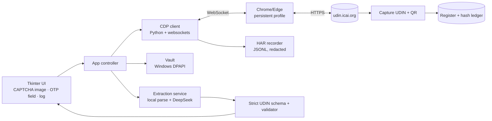

# UDIN Desktop App — architecture

**Goal:** a simple desktop app where the user supplies only **CAPTCHA** and **OTP**. Everything else — launching the browser, credentials, portal navigation, form filling, validation, submission, capture, stamping, register — runs in the background.

**Status:** proof-of-slice implemented in [`app/udin_app.py`](../app/udin_app.py) (login engine + CAPTCHA panel + OTP panel + DPAPI vault + HAR logging). Extraction, generation form fill, stamping and register are designed below but not yet built.

---

## 1. The decision that matters: real browser over CDP, not HTTP/HAR replay

The portal is an **Angular SPA on TCS DigiGov** with:

- client-side payload encryption (`encryptPassword`, `encryptFileUploadInput`, `encryptionService.encrypt`);
- four proprietary session headers (`ksad`, `otyb`, `kbxa`, `qqmm`) plus cookie auth;
- hashed bundles that change on every deploy;
- text CAPTCHA at login and a mandatory OTP at generation.

That makes raw `requests`/HAR **replay** a dead end (recon: 1/10). So the app drives a **real Chrome instance** over the DevTools Protocol, executes in-page **JavaScript/DOM fills** (native value setters + `input`/`change` events, exactly what Angular expects), and records network events as a **HAR-like JSONL for observability and regression fixtures — never for replay**.

Why this is the senior-engineer choice:
- the browser reproduces encryption/headers/cookies for free;
- selectors are stable business IDs (`username`, `password`, `captcha`, `certificateType`) not hashed CSS;
- a visible/persistent browser is honest to the portal and survivable across releases;
- HAR gives debugging and regression evidence without brittle reimplementation.

---

## 2. Components



| Module | Current | Responsibility |
|---|---|---|
| `ui` | Tkinter (working slice) | Shows CAPTCHA image, accepts CAPTCHA/OTP, displays status; later PySide6 or local web UI |
| `controller` | in `udin_app.py` | State machine, human-gate pauses, retries, fail-closed |
| `cdp` | `CDP` class | Command/event client over WebSocket, timeouts, event recorder |
| `chrome` | `ChromeSession` | Launches Chrome/Edge with a dedicated profile + remote debugging |
| `vault` | `vault_save/load` | DPAPI-encrypted per-Windows-user secrets (`%LOCALAPPDATA%\UDINApp`) |
| `har` | `CDP._event` | Network request/response JSONL — observability only |
| `portal` | `fill_login`, `captcha_png`, `fill_captcha_and_login`, `fill_otp_and_submit`, `detect_state` | Portal-specific automation |
| `extract` | planned | PDF/DOCX/scan → text/vision → DeepSeek → strict UDIN JSON |
| `validate` | planned | PAN/GSTIN, dates, 60-day, 44AB, ceiling, 5 e-filing params, duplicates |
| `stamp/register` | planned | Stamp before DSC, hash ledger, 60-day/48-hour clocks |

---

## 3. State machine

```
LAUNCH ─► LOGIN_PAGE ─► [fill credentials] ─► CAPTCHA_READY
   ▲                                              │ user types CAPTCHA
   │                                              ▼
   │                                        SUBMITTING_LOGIN
   │                          ┌───────────────────┼───────────────────┐
   │                          ▼                   ▼                   ▼
   │                     DASHBOARD            OTP_REQUIRED         LOGIN_ERROR
   │                          │                   │ user types OTP     │
   │                          │                   ▼                    ▼
   │                          │              SUBMITTING_OTP ─────► DASHBOARD / ERROR
   │                          ▼
   │                    GENERATE_UDIN ─► [payload from extraction]
   │                          │
   │                          ▼
   │                    SEND_OTP ─► OTP_REQUIRED ─► PREVIEW ─► SUBMIT ─► CAPTURED
   ▼
FAIL_CLOSED (selector/canary mismatch, lockout risk, unknown state)
```

Rules: never auto-submit the generation form; never persist OTP; never solve CAPTCHA; one login attempt per batch; stop on unknown state and show the browser.

---

## 4. What "only CAPTCHA and OTP" means in practice

| Step | Human? |
|---|---|
| Launch Chrome, load profile, open login | no |
| Fill SSP username + password from DPAPI vault | no |
| Extract CAPTCHA `` (base64 PNG) and show it in-app | **yes — read it** |
| Fill CAPTCHA, click LOGIN | no |
| Handle login OTP if the portal asks | **yes — OTP** |
| Reuse the authenticated session for later runs | no |
| Ingest document, extract fields, validate, fill form, preview | no |
| Send OTP, capture UDIN, stamp, register | **yes — OTP only** |

The app is a **member-operated assistant**: the two secrets that prove a human is present stay with the human; everything clerical is automated.

---

## 5. Security and reliability

- **Credentials:** DPAPI (user-scoped) via `win32crypt`; never in argv, logs or the repo; optional "don't remember".
- **OTP:** memory-only; cleared after submit; never logged or screenshotted.
- **Chrome profile:** dedicated `%LOCALAPPDATA%\UDINApp\chrome-profile`; holds session cookies — document BitLocker as a prerequisite, and support "forget profile" in the app.
- **Logs/HAR:** redact cookies, Authorization, OTP-shaped fields; store locally only.
- **Selectors:** prefer business IDs/placeholders (`#username`, `#password`, `#captcha`, `input[placeholder="<MRN>@icai.org"]`); re-verify on every release; fail closed on mismatch.
- **Session reuse:** one manual login per session; persisted profile avoids repeated CAPTCHA where the portal allows it.
- **Canary:** on boot, assert login-page markers (`#username`, `#captcha`, `LOGIN` button); abort to manual if missing.

---

## 6. Build slices

| Slice | Deliverable | Acceptance |
|---|---|---|
| **S0 (done)** | Chrome + CDP + HAR + CAPTCHA extraction + UI + DPAPI | `--selftest` extracts a valid CAPTCHA; UI starts; login page renders |
| **S1** | Login state machine (fill, CAPTCHA submit, OTP detect/submit) | One successful login with human CAPTCHA; OTP branch handled |
| **S2** | Document → UDIN JSON (local parse + OCR/vision + DeepSeek), confirmation UI | 5 sample docs produce correct payloads; edits tracked |
| **S3** | Generation form fill + Save Draft + Send OTP + Preview + Submit + capture | One real UDIN generated end-to-end; register row written |
| **S4** | Stamp before DSC, register, 60-day/48-hour clocks, e-filing 5-param check | Stamped PDF verifies after signing; parity vs portal CSV |
| **S5** | Packaging (PyInstaller), auto-update, signed installer, field dictionary refresh | Double-click install on a clean Windows machine |

---

## 7. Why not bundle Chromium now?

The machine already has Chrome and Edge; the slice launches the installed browser. Bundling Chromium (Playwright) is a packaging decision for S5 — it adds ~150 MB and a licence/update burden. The CDP contract is browser-agnostic, so switching later is contained.

---

## 8. Live facts captured (28 Oct 2026, authenticated)

- Login route `/ICAI/login`; fields `#username`, `#password`, `#captcha`; `LOGIN` button; CAPTCHA is `` as base64 PNG.
- Login used SSP credentials + CAPTCHA only — **no OTP at login** in this session; OTP appears at generation ("Send OTP").
- Generate page: Document Type radio values `37` Certificates and Other Reports (default), `38` Tax Audit, `3` Audit and Assurance Functions; figures typing values `1` numeric, `0` alphanumeric, `2` both (default); `#FRN`, `#certficateType`, date `DD-MM-YYYY`, description 5–250, remarks hidden from verifier.
- Member block pre-filled: name, MRN, email, PAN, pincode.

---

## 9. Open questions

1. OTP prompt DOM on the generation path (dialog vs page) — capture on first real generation.
2. Session lifetime and whether profile reuse skips CAPTCHA on subsequent runs.
3. Whether headless Chrome is acceptable to the portal; product default is a real, visible browser.
4. DeepSeek privacy posture (hybrid/local fallback) per the pipeline spec.
5. ICAI-sanctioned API track (roadmap Phase 5) remains the only path to zero-human.
