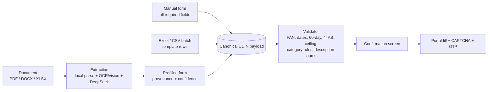

# Input modes — document, manual form, Excel

**One payload, three front doors.** Whatever the user supplies, the app produces the same
validated UDIN payload, shows the confirmation screen, then drives the portal. The only
human steps remain CAPTCHA and OTP.



## Mode A — give a document

- Accept `.pdf`, `.docx`, scanned PDF, and `.xlsx` (financial statements, audit report, certificate).
- Parse locally first (PyMuPDF / python-docx / stdlib XLSX reader), OCR only where needed, a vision model for layout/handwriting, and DeepSeek for ambiguous fields — every value must be a verbatim substring of the source.
- The form is **prefilled, not submitted**: each field shows confidence and the page region it came from; low-confidence fields block until confirmed.
- One document can map to **one or more UDINs** (a bundle), depending on signatures.

## Mode B — manual form (all required fields, live validation)

One screen, grouped:

| Group | Fields |
|---|---|
| Assignment | Category, sub-category/type, form/section, act/law, FRN, signing date, client name |
| Attestation | Auditor's opinion applicable/type, entity type, preceding-year block (audited last year, previous auditor, communication, fees) |
| Figures | Up to 3 "particulars + figure" rows (2 mandatory for certificates, 1 for audit/assurance) |
| Description | 5–250 character document description (portal charset only), optional remarks |

Validation runs before the portal is touched; errors are listed by field. The payload can be
saved as JSON and reloaded. Category-dependent fields are the only ones shown as required
(Tax Audit → form/section + s.44AB; Audit & Assurance → act/law).

## Mode C — Excel / CSV batch

Template: [`app/templates/udin_batch_template.xlsx`](../app/templates/udin_batch_template.xlsx)
(one header row, one sample row). Columns:

```text
category, sub_category, form_or_section, act_or_law, frn, signing_date,
client_name, pan, opinion_applicable, opinion_type, entity_type,
preceding_applicable, audited_last_year, prev_auditor, communication,
communication_date, outstanding_fees,
particulars_1, value_1, particulars_2, value_2, particulars_3, value_3,
description, remarks
```

- Each row becomes a payload; the **same validator** runs per row and reports row-level errors.
- Batch goes to the portal's native bulk path: **3–300 certificates** via Excel upload, **3–10**
  tax-audit/assurance UDINs via UI — one OTP per batch.
- Rows are mapped back to documents/UDINs after capture so the register stays complete.

## Validation matrix (enforced in `app/udin_model.py`)

| Check | Rule | Failure effect |
|---|---|---|
| Category | One of the three live categories | Blocks |
| Sub-category / type | Required; must match portal enum | Blocks |
| Form/section, act/law | Required for Tax Audit / Audit & Assurance respectively | Blocks |
| FRN | Required; "Not Applicable/Individual Capacity" allowed | Blocks |
| Signing date | `DD-MM-YYYY`, not future, within 60 days | Blocks |
| PAN of auditee | `AAAAA9999A` | Blocks |
| Client name | Required (Guidelines 2026 §8(b)) | Blocks |
| Description | 5–250 chars, portal charset (`. , _ - –`) | Blocks |
| Remarks | ≤250 | Blocks |
| Opinion block | Applicable Yes/No; type + entity type if Yes | Blocks |
| Preceding-year block | Applicable Yes/No; previous auditor/communication/fees if applicable | Blocks |
| Key fields | ≥2 for certificates, ≥1 otherwise; particulars ≤50 | Blocks |
| s.44AB | Turnover/gross receipts present for tax audit | Warning (portal may reject) |
| Individual capacity | Firm details in description | Warning |
| Client name in description | Avoid client details in descriptions | Warning |

## Status (28 Oct 2026)

| Piece | State |
|---|---|
| Canonical payload + validator (`app/udin_model.py`) | ✅ tested (valid + invalid payloads) |
| Excel template + batch reader (`app/make_template.py`, stdlib XLSX reader) | ✅ template created and read back; sample validates |
| Manual form UI (`app/form_ui.py`) | ✅ runs; validate / load Excel / save JSON |
| Document extraction (Mode A) | ⏳ next slice |
| Portal fill from payload (ng-select/opinion/figures) | ⏳ partial: login, FRN, date, description proven live |

## Run

```powershell
python app\form_ui.py
python app\form_ui.py --file app\templates\udin_batch_template.xlsx
python app\test_model.py
```
