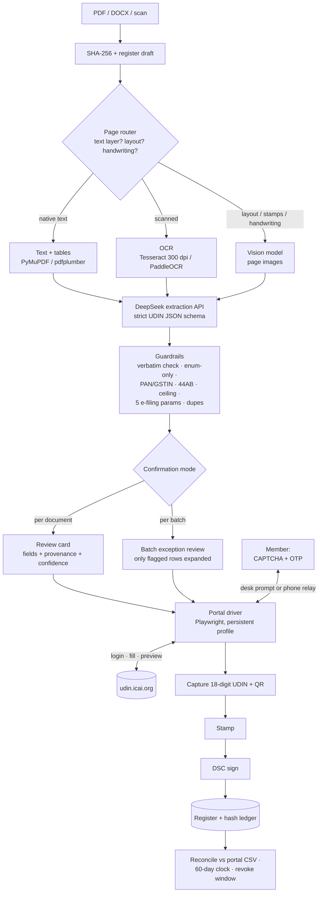

# UDIN Pipeline — Document → DeepSeek → Confirmation → Portal → OTP → UDIN

**Status:** design spec, confirmed with the user on **28 October 2026**. Complements [ROADMAP-AUTONOMY.md](../ROADMAP-AUTONOMY.md); supersedes the extraction description in [ROADMAP.md](../ROADMAP.md) Phase 1.
**Confirmed decisions:** **both** extraction modalities (**native text after OCR** *and* **page vision**); **both** confirmation modes (**per document** *and* **per batch**).

---

## 1. Pipeline at a glance



**Human steps in this pipeline:** confirm the extracted content (one review, per document or per batch), solve the login CAPTCHA, type the OTP. **Everything else — ingestion, parsing, OCR, vision, extraction, validation, form filling, capture, stamping, registration, reconciliation — is automated.**

---

## 2. Ingest and page routing

- Inputs: drag-and-drop, watch folder, email (IMAP/Graph), Drive/DMS webhook. Dedupe by SHA-256 before work starts.
- **Page router** runs per page, not per document: text-layer density, table presence, image coverage, handwriting/stamp detection. Pages can take different paths in the same PDF (e.g. digital cover + scanned annexures).
- Long documents (3CD, GSTR-9C): select **cover, signature block, financial statements, relevant clauses/tables**; never send the whole document to the model. Keep page numbers for provenance.
- Password-protected/unsupported files fail fast with a clear message; never silently skip.

---

## 3. Extraction paths (both modalities)

| Path | When | Tool | Output |
|---|---|---|---|
| **A — native text** | Text layer present (most digitally generated reports) | PyMuPDF (text + geometry), pdfplumber (tables) | Text blocks with page + bounding boxes |
| **B — OCR** | Scanned/image-only pages; carbon copies; faxes | Tesseract 300 dpi (`--psm 6`), PaddleOCR for dense tables | Text with confidence and boxes |
| **C — vision** | Layout-heavy pages, stamps/seals, handwriting, degraded scans, tables OCR mangles | Vision-capable model over page images (DeepSeek-VL self-hosted, or a vetted vision API; verify the hosted DeepSeek API's current modality at build time) | Structured fields with page references |

**Cross-check policy (non-negotiable):**
- Amounts, PAN/GSTIN, dates, form numbers and period fields are extracted by **two paths** where feasible (e.g. text + vision, or OCR + vision).
- Agreement → high confidence. **Disagreement → forced human confirmation**, never a majority vote and never a model guess.
- Vision is the primary path for scans when available; OCR remains the fallback when vision is unavailable or times out.
- Every field carries `page`, `bbox`, `path_used` and `confidence`.

---

## 4. DeepSeek extraction contract

**Two passes:**
1. **Classify** — category (Certificates / GST & Tax Audit / Audit & Assurance), sub-category/form/section, document family. Enum-only output.
2. **Extract** — strict JSON for the chosen schema; one retry with the neighbouring page if a mandatory field is missing.

**Model settings:** `deepseek-chat` (JSON mode / function calling), temperature 0, deterministic decoding; chunk by page groups, not by whole document. Vision path uses a vision-capable model with the same schema.

**Payload schema (seed):**

```json
{
  "category": "Certificates | GST_TaxAudit | Audit_Assurance",
  "sub_category": "<portal enum>",
  "form_or_section": "<portal enum or null>",
  "act_or_law": "<portal enum or null>",
  "frn": "<firm registration number | INDIVIDUAL>",
  "client_name": "<Guidelines 2026 §8(b)>",
  "signing_date": "YYYY-MM-DD",
  "pan_of_auditee": "AAAAA9999A",
  "auditor_opinion": {"applicable": true, "type": "Unmodified|Qualified|Adverse|Disclaimer",
                       "kam": false, "eom": false, "other_matter": false,
                       "going_concern": false, "entity_type": "Listed|Non-Listed"},
  "preceding_audit": {"applicable": true, "audited_last_year": "Yes|No|FirstYear",
                       "prev_udin": null, "prev_auditor_mrn": null,
                       "communication_made": null, "communication_date": null,
                       "outstanding_fees": "Yes|No|NotKnown"},
  "key_fields": [{"particulars": "<=50 chars", "value": "<number|text>",
                   "type": "numeric|alphanumeric", "denomination": "INR|null"}],
  "document_description": "5-250 chars",
  "moc": {"applicable": false, "rows": []},
  "preliminary_44ab": {"cash_le_5pct": null, "turnover": null,
                        "gross_receipts": null, "sec_44ad_4": null,
                        "deemed_profit_lower": null, "total_income_gt_bel": null},
  "confidence": {"category": 0.0, "signing_date": 0.0},
  "provenance": [{"field": "pan_of_auditee", "page": 1, "bbox": [0,0,0,0]}]
}
```

**Guardrails (enforced in code, not prompt-only):**
- Every string value must appear as a **normalised substring** of the source text (dates/amounts regex-normalised); otherwise downgrade to `unknown`.
- Enum fields may only take values fetched from the portal; the model may **choose** an option but never invent one.
- No date arithmetic by the model: dates are read, then validated in code.
- Confidence below threshold → blank field + review flag, never a plausible guess.
- **Never auto-submit** a payload; confirmation is a required gate.

**Cost/latency:** cache by document hash + schema version; per-page token budget; async queue; retry only the failed page, not the document.

---

## 5. Privacy and data handling (decide per firm)

**Default: hybrid, minimised.**
- Deterministic local extraction for identifiers and figures where possible; DeepSeek used for classification, opinion wording and descriptions.
- Send only the pages needed; redact non-essential personal data; never send credentials or the register.
- DeepSeek cloud is a **third-party processor**: require a DPA/no-retention/no-training position, client consent where needed, and a DPDP note in the engagement letter. Data-residency concerns are real; offer a **local/self-hosted model** fallback for clients who refuse cloud processing.
- Log field metadata, never raw document text or API prompts.

---

## 6. Confirmation UX (both modes)

### 6.1 Per document
Full review card mirroring the portal: every field, its value, confidence chip, and **one-click provenance** (page image with the source region highlighted). Edits are allowed; low-confidence fields block approval until checked. Immutable-submission warning; then fill → OTP → portal Preview → Submit.

### 6.2 Per batch
Grouped by category/FRN/signing date. Batch summary: counts, categories, ceiling remaining, total key figures. **Only flagged rows are expanded**; clear rows are listed with a compact confidence indicator. The member approves the batch (or holds exceptions) and then supplies **one OTP** for the portal batch (Certificates 3–300 via Excel; Tax Audit / Assurance 3–10 via UI). Returned UDINs are mapped back to each document.

**Default policy:** per-document for audit reports/tax audits (high stakes); per-batch for certificates. Configurable by the firm, per category.

**Second checkpoint:** the portal's own **Preview** screen after OTP verification is always shown before Submit — two eyes on the payload, never auto-submit.

---

## 7. Portal submission, OTP, capture

1. **Login:** SSP username (`MRN@icai.org`) + password from the vault; **CAPTCHA shown to the member** (never solved programmatically); login OTP if the portal asks.
2. **Fill:** Playwright role/label locators; persist a portal **draft** before asking for any OTP.
3. **OTP:** the portal sends it to the member's registered mobile **and** email. The member types it within **90 seconds** (OTP valid 5 min, max 5 resends). Hard stop before the resend limit; never auto-retry.
4. **Preview → Submit** with the member present; capture the 18-digit UDIN + QR (DOM + `getQRCodeData`).
5. **Batch mode:** same gates, once per batch.

---

## 8. Post-generation

- **Stamp** the UDIN + QR below the signature block and in the footer **before** DSC signing; block already-signed inputs (offer unsigned copy / re-sign / covering letter).
- **Register:** one row per UDIN with document hash, category, key fields, opinion/prior-year/MoC, timestamps, 60-day and 48-hour clocks.
- **Reconcile** against the portal `List UDIN` CSV; run the e-filing 5-parameter check; generate client communication if the UDIN is not printed; produce verifier notices on revocation.

---

## 9. Failure modes and fallbacks

| Failure | Detection | Fallback |
|---|---|---|
| Poor scan / OCR garbage | per-page confidence, gibberish ratio | vision path; else manual entry with page image |
| Vision timing out / unavailable | timeout, provider error | OCR + text path; queue for retry |
| DeepSeek returns invalid schema | JSON validation | retry once with page context; then manual |
| Model invents a value | verbatim-substring guard | drop value, flag field |
| Text/vision disagree on money | cross-check comparator | force human confirmation |
| Portal selector change | canary smoke test | fail closed, manual mode, no mis-fill |
| OTP timeout / 5 resends | timer + attempt counter | abort cleanly, keep draft, hand to manual |
| Batch partial failure | per-row status reconciliation | retry failed rows only; never duplicate a UDIN |
| Ceiling / quota exhausted | pre-flight counter + portal error | hold batch, alert, do not attempt |

---

## 10. Metrics

- Field-level extraction accuracy (per document type, per path).
- Vision-vs-OCR delta on the same pages.
- Confirmation edit rate (fields changed / fields extracted).
- Straight-through rate (documents approved without edits).
- Time: upload → UDIN; OTP first-attempt success; batch success.
- Invalidated UDINs (e-filing 5-param) and portal/register parity.

---

## 11. Open questions

1. Does the hosted DeepSeek API expose a vision/PDF endpoint at build time, or do we self-host DeepSeek-VL (or use another vision model)?
2. Which fields may leave the machine at all (client redaction policy), and which clients require local-only processing?
3. Default confirmation mode per category, and whether a "trusted template" can auto-approve high-confidence certificates.
4. Batch cap interplay: multiple 300-row certificate files per day, tax-audit batches of 10 — how to schedule under the 60-audit ceiling.
5. Register format once ICAI prescribes one; client-communication template.
