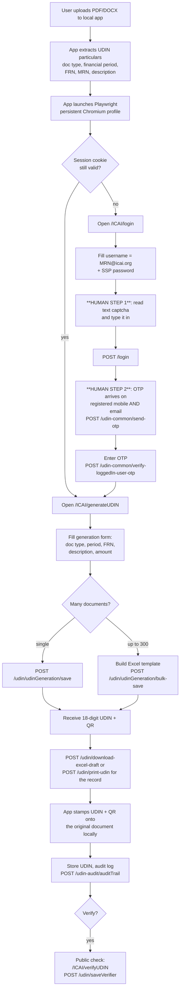

# UDIN Portal (`udin.icai.org`) — Technical Recon for Automation

**Author:** `udin-recon` (technical recon teammate)
**Access date for all observations:** **2026-10-27** (IST)
**Scope:** Passive, read-only analysis of **publicly served** pages and JavaScript bundles. No login, no account creation, no credential/OTP submission, no captcha solving, no UDIN generation, no scanning or fuzzing, no probing of internal hosts.
**Nature:** Every claim below is tagged with its source. Items only observable after login are listed separately in §11 — nothing in that list is asserted as fact.

---

## 1. TL;DR — Feasibility verdict

| Automation mode | Feasibility | Why |
|---|---|---|
| **Fully unattended** (headless server, no human) | **1 / 10 — effectively blocked** | Server-validated **text captcha** on login + **mandatory OTP** to the CA's registered mobile **and** email before *every* UDIN generation + no public member API + custom per-request session/encryption headers. |
| **Human-in-the-loop browser automation** (recommended) | **7 / 10 — viable** | Deterministic Angular UI and clear endpoint family; the human does captcha + OTP; the app does document parsing, field filling, generation, stamping. |
| **Bulk generation via Excel upload** (for volume) | **6 / 10 — viable, same auth friction** | Portal natively supports Excel bulk upload of up to **300 UDINs** per file; still requires the same login + OTP. |
| **UDIN verification / search** | **9 / 10 — easy** | Public `/ICAI/verifyUDIN` route and pre-login print/validate endpoints exist. |
| **`requests`/HTTP replay (no browser)** | **1 / 10 — do not attempt** | Request payloads are encrypted client-side (`encryptPassword`, `encryptFileUploadInput`, `encryptionService.encrypt`), plus 4 proprietary session headers (see §5). Reverse-engineering this is fragile, ToS-risky and would need re-doing on every release. |

**Recommended stack:** **Playwright (Python) + persistent Chromium profile + explicit UI pause for human captcha/OTP entry**. Package in Electron only if a double-click desktop app is a hard requirement (§9).

**Confidence:** **High** on architecture, auth mechanics and endpoint inventory (direct bundle evidence). **Medium** on exact wire-level field names and session lifetimes (require authenticated observation).

---

## 2. What the portal actually is

The portal is **not** ASP.NET WebForms. It is an **Angular SPA** built on a **TCS DigiGov** platform product, hosted on an Apache-style static server.

- `/` returns a **1,276-byte HTML shell**: `<app-root></app-root>`, `<base href="/">`, and four hashed bundles (`runtime.*.js`, `polyfills.*.js`, `scripts.*.js`, `main.*.js`). No `__VIEWSTATE`, no `__EVENTVALIDATION`, no `ASP.NET_SessionId`, no `<form action>`.
  Source: `https://udin.icai.org/` (fetch, 2026-10-27).
- `server:` header is generic `Server`; `Last-Modified: Fri, 02 Oct 2026`; `ETag` present → static file server in front of an API.
- Response headers observed: `Content-Security-Policy: default-src 'self'; connect-src *; script-src * 'unsafe-inline' 'unsafe-eval' blob: …`, `X-Frame-Options: SAMEORIGIN`, `Strict-Transport-Security: max-age=31536000; includeSubDomains; preload`, `X-Content-Type-Options: nosniff`, `Referrer-Policy: same-origin`.
  Source: response headers for `https://udin.icai.org/` (2026-10-27).
- Bundle sizes: `main.c0c7d3a3d8a2cb46.js` = **9,845,557 bytes**; `scripts.*.js` = 2,015,805; `polyfills.*.js` = 33,995; `runtime.*.js` = 5,614.
  Source: `https://udin.icai.org/main.c0c7d3a3d8a2cb46.js` and siblings (2026-10-27).
- Build config found in `main.js`: `baseUrl:"https://udin.icai.org"`, `defaultContextPath:"/digigov"`, `environment:"Production"`, `dev:!1`, branding `"Copyright © 2025 Tata Consultancy Services"`, `defaultTheme:"dg-icai"`.
- Feature modules are **lazy-loaded** numeric chunks (runtime map `f.u` → `{19:"eb131743…",47:"e073b745…",254:"a64c5abda2…"}`), so per-screen code is *not* in the initial bundle. Only `/login`, `/main`, `/ICAI/*`, `/file-window`, `/privacy`, `/unauthorized` appear as eager `path:` entries.
- `body` carries `oncontextmenu="return false;"` (right-click disabled) — a cosmetic anti-inspection measure only.
- Note: `web_fetch` on the SPA routes returns the text "UDIN" only (the shell title), which is exactly what a client-side-rendered app looks like to a non-JS fetcher. Raw HTTP is required for recon; the site did **not** block our fetches (HTTP 200 throughout).

---

## 3. Expected automation flow (as the portal is actually built)

> **Design consequence:** two mandatory human gates (captcha, OTP) sit *before* any automation value is delivered, and OTP is required **again at UDIN-generation time even after login**. Any product must be designed around a human pause, not pretend to remove it.

**Bundle evidence for the post-login OTP gate** — the app literally ships this dialog string:

> `"You Cannot Generate UDIN Wihout OTP verification.If you doe not have Email-id Or Mobile Number Please Select SSP Portal."`
> — `main.c0c7d3a3d8a2cb46.js`, `goBack()` of the OTP dialog component (2026-10-27). *(typos are in the shipped string)*

---

## 4. Login mechanics (public evidence)

Official login instructions, from ICAI's published UDIN FAQ (`https://udin.icai.org/assets/images/FAQs%20on%20UDIN.pdf`, accessed 2026-10-27), state the member must:

1. enter **Username in the format `<MRN>@icai.org`** (same as SSP login),
2. enter the **Password used for SSP login**,
3. **enter the Captcha displayed on the screen** ("If the captcha is unclear, please refresh it"),
4. then confirm an **OTP received on registered mobile number and email ID**, after which the Dashboard appears.

Corroborated in code (`main.js`):

- `captchaType:"text"` in the **Production** `appConfig` → the live login uses a **classic image/text captcha**, *not* Google reCAPTCHA.
- `recaptchaV3SiteKey:"6LdvCuEcAAAAAOxl35bnqCM5mO_HmICdfBbz3aHI"` and a `RECAPTCHA_V3` code path exist, but are only armed if `captchaType === "recaptchav3"` — i.e. **reCAPTCHA v3 is available but not the production setting**. The key is public by design.
- `GET /security/captcha` exists as an endpoint → server-generated captcha image.
- `encryptPassword:!0` and `encryptFileUploadInput:!0`; login body built with `URLSearchParams` and a `_fc` field appended (`getLoginRequest`), then `POST /login`.
- `authType:"cookie"` for production, with an optional `oauth2` path configured: `oauth2Config.issuer = "https://udin.icai.org/oauth2/token"`, plus `clientId`, `scope`, `requireHttps:!0`, `tokenType:"custom"`, `refreshTokenType:"custom"`, `addDeviceId` handling.
- `afterLoginLandingUrl:"/ICAI"`, `unauthorizedUrl:"/ICAI/unauthorized"`, role-based landing by group IDs → `/ICAI/generateUDIN`, `/ICAI/admin-dashboard`, `/ICAI/udin-logs`, else `/main`.
- An **inactivity session dialog** ships with a live countdown (`"… Seconds of inactivity."`) → server-side idle timeout exists; exact duration **not** observable publicly.

**Confidence:** high that production = MRN@icai.org + SSP password + **text captcha** + OTP. The FAQ and the shipped `captchaType:"text"` agree independently.

---

## 5. Why `requests`/HTTP replay is the wrong path

Three independent obstacles, all visible in the public bundle:

1. **Client-side payload encryption.** `encryptionService.encrypt(...)` / `param3` / `cipherText` are used for MRN, password and file-upload inputs (`encryptFileUploadInput:!0`, `P2_DATA_ENC_ENABLE:!1`). Reproducing this means re-implementing a JS crypto helper per release.
2. **Four proprietary session headers.** Every request is decorated via `generateSessionClientId(1..4, clientId)` and set on headers named by constants `PARAM1..PARAM4` = `"ksad"`, `"otyb"`, `"kbxa"`, `"qqmm"`. One of them is an `encryptionService` ciphertext. Cookie auth alone is insufficient.
3. **Hashed-bundle churn.** `main.<hash>.js` changes on every deploy; any hard-coded extraction of keys/header logic breaks silently.

A browser gives all three for free; a hand-rolled HTTP client does not. **Recommendation: do not build an HTTP replay client.**

---

## 6. Endpoints observed in public JavaScript

All paths below are **literal strings in `main.c0c7d3a3d8a2cb46.js`** (fetched 2026-10-27). They are extracted from the shipped client, i.e. they are what the browser calls — **not** independently confirmed to exist server-side. Confidence: *observed in client code*.

### 6.1 Authentication / session

| Method | Path | Purpose (from call site) |
|---|---|---|
| POST | `/login` | Login submit (`_fc` field appended; URL-encoded body) |
| POST | `/logout` | Logout |
| GET | `/security/captcha` | Captcha image/text fetch |
| GET | `/security/access-token` | Access token for opening external URLs |
| POST | `/security/initialize-login-dtls` | Pre-login initialisation |
| POST | `/security/forgot-password/check-prerequisite`, `/security/forgot-password/verify-user`, `/security/forgot-password/validate-password`, PUT `/security/forgot-password/reset-password` | Forgot-password chain |
| PUT | `/security/change-password`, `/security/reset-password` | Password change/reset |
| GET | `/security/password-policy`, `/security/change-password/check-prerequisite` | Policy preconditions |
| POST | `/security/unlock-user`, PUT `/security/user-activation` | Unlock / activate account |
| GET | `/core/user-preferences`, POST `/core/save-user-preferences`, GET `/core/labels` | UI prefs / i18n |
| GET | `/access-control/user-privileges`, `/access-control/priv-urls` | Privilege map |
| GET | `/core/switch-post`, PUT `/core/switch-post/selected-post-id` | CA/firm post switching |
| POST | `/admin/visitor-detail` | Visitor counter |

### 6.2 OTP (the critical path)

| Method | Path | Notes |
|---|---|---|
| POST | `/udin-common/send-otp` | `sendOtp(body, queryParams)` → OTP dispatched; channel(s) inferred as registered mobile **and** email (FAQ) |
| POST | `/udin-common/verify-otp` | Generic OTP verification |
| POST | `/udin-common/send-loggedIn-user-otp` | Re-send OTP for an authenticated session |
| POST | `/udin-common/verify-loggedIn-user-otp` | Post-login OTP verification (gate before generation) |

Bundle quote: `sendOtp(C,k){return this.http.post("/udin-common/send-otp",C,{params:k})}`
Resend/timeout/retry limits: **not present in public bundle** → §11.

### 6.3 UDIN generation & documents

| Method | Path | Purpose |
|---|---|---|
| POST | **`/udin/udinGeneration/save`** | **Generate a single UDIN** |
| POST | **`/udin/udinGeneration/bulk-save`** | **Generate in bulk (Excel-driven)** |
| POST | `/udin/savedraftDtls` | Save draft particulars |
| POST | `/udin/get-UDIN-Details`, `/udin/getUdinDetailsById` | Retrieve UDIN record |
| POST | `/udin/getQRCodeData` | **QR code payload for a UDIN** |
| POST | `/udin/print-udin`, `/udin/prelogin-print` | Printable UDIN record |
| POST | `/udin/revokeUdin` | Revoke (guidelines: within 48h, with reason) |
| POST | `/udin/download-excel-draft/{id}` | Export draft(s) |
| GET | `/udin-config/fetchUdinDocumentType/{id}`, `/udin-config/docSubType/{id}`, `/udin-config/docSubTypeChild/3/{id}` | Document-type pickers |
| GET | `/udin-config/fetchLoggedInMRNDtls`, `/udin-config/getDyCoFiDetails/{id}` | Member/firm auto-fill |
| POST | `/udin-config/get-combo-list`, `/udin-config/get-quota`, `/udin-config/get-approver-quota`, `/udin-config/getEffectiveUdinCount` | Dropdowns + quota |
| POST | `/udin-config/udinCount/{a}/{b}/{c}/{d}/{e}`, `/udin-config/udinCountDownload/…` | Counts / downloads |
| GET | `/udin-config/bulk-upload/dynamic-template/download/{id}` | **Bulk-upload Excel template download** |
| POST | `/udin-config/requestAnotherMrn`, `/udin-config/approve` | MRN request / approval |
| POST | `/dms/file-upload`, `/dms/merge-doc`, `/dms/update-document-dtls`, `/dms/delete-file`, GET `/dms/document-metadata`, `/dms/pdf-licence` | Document management (upload, merge, licence) |
| POST | `/ocr/auto-compression`, `/ocr/img-compress`, `/ocr/cancel-compress` | Image compression before upload |
| POST | `/udin-audit/auditTrail`, `/udin-audit/getUdinLogs`, `/udin-audit/getVerifier`, `/udin-audit/get-member-history`, `/udin-audit/save-as-excel`, `/udin-audit/download-as-excel` | Audit trail / logs |

### 6.4 Verification (public-facing capability)

| Method | Path | Purpose |
|---|---|---|
| POST | **`/udin/saveVerifier`** | Verify a UDIN (single) — UI entry point is route `/ICAI/verifyUDIN` |
| POST | **`/udin/saveBulkUdinVerifier`** | Bulk verify |
| POST | `/udin-common/bulk-udin-verifier/data-populate`, `/udin-common/bulk-udin/data-populate/{id}` | Populate bulk-verify grid |
| POST | `/udin-common/validateUDIN/{udin}` | Validate a UDIN number |
| POST | `/udin-common/get-reg-attr-value` | Registration attribute lookup |
| POST | `/external/getcbdtdetails`, `/external/getoreradetails`, `/external/getreradetails` | Regulator lookups (CBDT / e-ORERA / e-RERA) |
| POST | `/udin-extAPI/getMembersByFRN`, `/udin-extAPI/getSSPFirmDetails` | **"extAPI" — external/integration API surface** |

### 6.5 UI routes (public, eager)

`/login` · `/main` · `/ICAI` · `/ICAI/login` · **`/ICAI/verifyUDIN`** · `/ICAI/about-udin` · `/ICAI/generateUDIN` · `/ICAI/udin-logs` · `/ICAI/admin-dashboard` · `/ICAI/quotaDetails` · `/ICAI/raise-grievance` · `/ICAI/view-grievance` · `/ICAI/unauthorized` · `/privacy` · `/file-window` · `/onlyoffice-window` · `/useractivation/:id` · `/payment-gateway`

Note: `#`-less paths, `base href="/"`, and the app also serves `/digigov` as its default context path — expect the real login to be reachable at both `/ICAI/login` and via `/`.

---

## 7. Form fields

> **Caveat:** exact DOM `name`/`id` attributes for the login form live in a **lazy-loaded chunk** that we did not enumerate (public route HTML is an empty `<app-root>`). Values below are *inferred* from code paths and marked accordingly. Treat §11 as the source of truth until captured on a real page.

| Screen | Field (business meaning) | Wire/code evidence | Confidence |
|---|---|---|---|
| Login | Username = `<MRN>@icai.org` | FAQ PDF; login code | **High** (documented) |
| Login | Password (SSP password) | FAQ PDF; `encryptPassword:!0` | **High** |
| Login | Captcha answer (text) | `captchaType:"text"`; `GET /security/captcha` | **High** (field *name* low) |
| Login | reCAPTCHA response `g-recaptcha-response` | only when `captchaType==="recaptchav3"` | Medium (alternative mode) |
| Login | `_fc` hidden/extra form field | `params.append("_fc", R)` | Medium |
| Login | 4 session headers `ksad`/`otyb`/`kbxa`/`qqmm` | `PARAM1..4` constants + `generateSessionClientId` | Medium (names high, values opaque) |
| OTP | OTP code (numeric) | `/udin-common/verify-otp`, `verify-loggedIn-user-otp` | High (existence) |
| OTP | OTP channel params | `sendOtp(C, {params:k})` | Low — §11 |
| UDIN generation | Document type / sub-type / child | `/udin-config/fetchUdinDocumentType`, `docSubType`, `docSubTypeChild` | High (existence) |
| UDIN generation | Member MRN, firm FRN, period, description, amounts | `/udin-config/fetchLoggedInMRNDtls`, `getDyCoFiDetails`; guidelines | Medium |
| UDIN generation | Quota / acquired-UDIN count | `get-quota`, `getEffectiveUdinCount`, `udinCount` | High (existence) |
| Bulk generation | Excel file (≤300 rows) | `bulk-save` + template download | **High** (ICAI announcement) |
| Verification | Verifier name, mobile, email, OTP(s) | FAQ PDF (min 2 / max 10 UDINs; separate OTPs to email + mobile) | **High** (documented) |

No `__VIEWSTATE` / `__EVENTVALIDATION` / ASP.NET cookies exist — **confirmed absent**, this is not WebForms.

---

## 8. Bulk generation and verification — what ICAI itself publishes

- **Bulk generation:** ICAI announcement *"Generation of UDIN in Bulk for Certificates"*, 17-06-2020 — a provision was added to generate UDIN in bulk **"uptil 300 UDINs"** for certificate types **"in one go… through uploading of an excel file"**.
  Source: `https://icai.org/post/generation-of-udin-in-bulk-for-certificates-17-06-2020` (accessed 2026-10-27). Template download endpoint `/udin-config/bulk-upload/dynamic-template/download/{id}` matches.
- **Bulk verification (for banks/regulators):** FAQ describes **Bulk Verify — minimum 2, maximum 10 UDINs** per attempt, verifier enters name + mobile + email, **separate OTPs are sent to the entered email ID and mobile number**, and **both OTPs must be validated**.
  Source: `https://udin.icai.org/assets/images/FAQs%20on%20UDIN.pdf` (accessed 2026-10-27).
- **QR code:** 18-digit UDIN is issued **with a QR code**; QR payload retrievable via `/udin/getQRCodeData`.
  Sources: `https://icai-call-sahayata.icai.org/assets/pdf/UDIN%20FAQ.pdf` (search excerpt) and bundle endpoint.
- **No public member-facing generation API exists.** The *Comprehensive Guidelines on UDIN* state the Directorate may integrate UDIN with government/regulator portals and that **"The Institute may enter into Memoranda of Understanding or API-based arrangements with such agencies to enable automatic validation of UDIN-linked documents"**. That is an **institutional/regulator** API route, **not** an API for individual CAs or third-party apps.
  Source: `https://udin.icai.org/assets/images/UDIN%20Guidelines.pdf` (text extracted, accessed 2026-10-27).
- The only "API" strings in the client are `"/udin-extAPI/getMembersByFRN"` and `"/udin-extAPI/getSSPFirmDetails"` — server-to-server helpers used *by* the portal; no documentation, keys, or auth model is public. **Do not treat as an available API.**
- Latest published context: UDIN generation limit is **60 days from date of signing** (raised from 15 days w.e.f. 17-09-2021); revocation allowed **within 48 hours** with reason.
  Source: same FAQ / Guidelines PDFs (accessed 2026-10-27).

---

## 9. Recommended automation stack

**Primary: Playwright (Python) + persistent Chromium profile + explicit human gates.**

- **Persistent profile** (`launch_persistent_context(user_data_dir=...)`): the CA completes login **once**; the session cookie + device fingerprint survive restarts, so daily runs usually skip the captcha. Do **not** copy profiles between machines (device-binding hints: `addDeviceId` in the oauth2 config).
- **Human gate 1 — captcha:** open the browser **headed** (or expose a local "Finish login" window) and let the human type the captcha. *Never* auto-solve it: it is a deliberate access control, and circumventing it is both a ToS/security violation and a single point of catastrophic failure (account suspension).
- **Human gate 2 — OTP:** pause the automation, show "OTP sent to registered mobile + email — enter it here", then let the script submit `/udin-common/verify-loggedIn-user-otp` **through the UI**. Time-box the pause; on timeout, abort cleanly and surface the draft for later.
- **Generation:** drive the real Angular form (`/ICAI/generateUDIN`) with Playwright's role/label locators, prefer `get_by_role`/`get_by_label` over CSS (hashed classes change every build).
- **Volume:** implement **bulk Excel path (≤300 rows)** for batches — a native portal feature, far more robust than 300 UI round-trips.
- **Document stamping is a local step, not a portal step.** The portal issues the UDIN + QR; stamping the PDF/DOCX is your own offline work (e.g. `pypdf`/`pdf-lib` + `qrcode`). Do not expect a portal "stamp" endpoint.
- **Session handling:** detect the inactivity dialog (shipped countdown) and the `/ICAI/unauthorized` redirect; re-auth path must fall back to the human gates, never to stored credentials in plaintext.
- **Secrets:** store nothing that can generate a UDIN without the human (no OTP autofill, no captcha cache). Keep credentials in Windows Credential Manager / DPAPI.

**Embedded WebView2 — viable packaging layer, weaker automation target.** A Windows app can host WebView2 and drive the same portal (WebView2 *is* Chromium and can expose CDP via `WEBVIEW2_ADDITIONAL_BROWSER_ARGUMENTS=--remote-debugging-port=<n>`), which gives a native window, a persistent user-data folder and a familiar "browser inside my app" UX. **But**: there is no first-class Playwright binding — you drive it over raw CDP or `connect_over_cdp`; its lifetime/teardown is tied to the host control; instrumenting the two human gates (captcha, OTP) is harder; and debugging is materially worse than a standalone browser. **Verdict: Playwright + persistent Chromium remains the primary engine; choose WebView2 only if a single-window native desktop shell is a hard product requirement, and then drive it over CDP rather than re-implementing via WebView2 events.** Starting with WebView2 turns a 7/10 problem into roughly a 5/10 one for cosmetic gain.

**Electron shell — only if packaging demands it.** Wrap the same Playwright/Python core (or use `playwright` via Node). Electron buys distribution and a native window, not reliability; it adds auto-update and signing work. Prefer **Tauri/Electron wrapper around a Python sidecar** only after the Playwright flow is proven.

**Explicitly rejected:** headless HTTP replay (`requests`), captcha-solving services, OTP interception from email/SMS. All three are either technically brittle (§5) or violate the portal's access controls and ICAI's IT-security posture.

---

## 10. Risk register

| # | Risk | Severity | Evidence / reasoning | Mitigation |
|---|---|---|---|---|
| R1 | **Captcha blocks unattended login** | High | `captchaType:"text"`; `GET /security/captcha`; FAQ instructs entering the displayed captcha | Human gate; persistent profile to minimise frequency |
| R2 | **OTP mandatory even after login** | High | Shipped dialog: *"You Cannot Generate UDIN Wihout OTP verification…"*; `/udin-common/send-otp`, `verify-loggedIn-user-otp` | Design product around a human OTP step; never promise "fully automatic" |
| R3 | **No sanctioned API for members** | High | Guidelines: API/MoU arrangements are for government/regulator agencies only | Keep UI automation; do not market as "API integration" |
| R4 | **Client-side payload encryption + 4 custom session headers** | High (for HTTP replay) | `encryptionService.encrypt`, `encryptPassword`, `encryptFileUploadInput`, `PARAM1..4` = `ksad/otyb/kbxa/qqmm` | Use a real browser; avoid reverse-engineering |
| R5 | **Account lockout / failed-login policy unknown** | High | `/security/unlock-user` exists ⇒ lockouts happen; threshold not public | Never retry blindly; cap attempts at 1 and hand back to human |
| R6 | **Session/idle timeout mid-workflow** | Medium | Inactivity dialog with live "Seconds of inactivity" countdown; `/ICAI/unauthorized` | Save drafts (`/udin/savedraftDtls`); resume, don't restart |
| R7 | **Hash-churn breaks selectors/integration** | Medium | `main.<hash>.js` + numeric lazy chunks change each release (Oct 2026 build observed) | Role/label locators; smoke-test on boot; no brittle XPath on hashed classes |
| R8 | **Anti-debug / anti-inspection shipped** | Low–Medium | `oncontextmenu="return false"`; `disable-devtool` library imported and wired behind `disableDevTools` (**currently `false` in prod config**) | Do not depend on devtools; treat config as likely to flip to `true` |
| R9 | **ToS / disciplinary exposure** | Medium | ICAI *Terms and Conditions* (`icai.org/post/16566`) is a generic disclaimer with **no explicit anti-automation clause**; UDIN **Guidelines Ch. IX — "Non-Compliance and Disciplinary Consequences"** exists; UDIN portal has own `/privacy` route | Disclose human-in-the-loop; never share credentials; see §12 |
| R10 | **Pre-production host exposed in bundle** | Low | `https://preprodudin.icai.org` appears as a literal in `main.js` | **Never** point automation at preprod — out of scope, unauthorised |
| R11 | **Internal service URL leaked in bundle** | Informational | `http://10.170.80.113:8082/ai/orchestration/...` (an internal RFC1918 AI/STT service) | Record only. **Do not probe.** Off-limits internal infrastructure |
| R12 | **Wrong-document / wrong-period UDIN** (business risk, not technical) | High | UDIN is irrevocable after 48h (`revokeUdin`) and a revoked UDIN invalidates the filed form (FAQ Q65/Q66) | Mandatory human confirmation of doc type + period before submit; never auto-submit extracted values blind |
| R13 | **Rate limits** | Unknown | Not published; no evidence either way | Throttle; batch via Excel path; back off on 429/5xx |

---

## 11. REQUIRES AUTHENTICATED ACCESS TO VERIFY

Nothing here is confirmed. Each item needs a **manually authorised, human-performed** session — never a scripted login.

**Login & OTP**
1. Which channel(s) `POST /udin-common/send-otp` actually uses (mobile, email, or both) and the exact request/response schema.
2. OTP **length, validity window, resend cooldown, max resend count, max wrong-OTP attempts**, and lockout consequence.
3. Whether login requires OTP on **every** session or only first/risky sessions; whether "remember this device" exists.
4. Exact DOM field names/IDs for username, password, captcha on `/ICAI/login`, and whether the captcha is image-only or also has an audio/refresh variant.
5. Real idle-session timeout duration and whether drafts survive it.
6. Whether `disableDevTools` is flipped to `true` at runtime despite `false` in the static config.
7. Whether the 4 session headers (`ksad/otyb/kbxa/qqmm`) are strictly required and how they are derived per request.

**Generation**
8. Full field set and validation rules of the generation form (mandatory fields, period format, amount handling, description limits, FRN/MRN auto-fill behaviour).
9. Actual request/response shape of `/udin/udinGeneration/save` — including how the uploaded document reference is bound, and whether the document must be uploaded before or after UDIN creation.
10. Whether a document attachment is **mandatory** to obtain a UDIN, and accepted formats/size limits (`/dms/file-upload`, `/ocr/img-compress` suggest images are compressed).
11. Quota model semantics (`get-quota`, `getEffectiveUdinCount`, approver quota) and what happens when quota is exhausted.
12. Bulk Excel **exact column schema** and error-reporting format (`bulk-save`), plus per-file and per-day caps.
13. Real rate limits / throttling behaviour on generation endpoints.

**Verification**
14. Whether `/ICAI/verifyUDIN` (and `POST /udin/saveVerifier`) is truly usable **without login**, and its exact OTP-to-verifier flow (FAQ implies verifier name + mobile + email + dual OTP).
15. Whether the QR on a UDIN resolves to a public URL and its format (`/udin/getQRCodeData` response shape).

**Legal / policy**
16. The UDIN portal's own Terms of Use (likely under `/ICAI` or `/privacy`) — we reviewed only ICAI's general website T&C, which contains no automation clause.
17. Any ICAI IT-security advisory / circular restricting automated access to `udin.icai.org` — none found in public search on 2026-10-27.

---

## 12. Legal / ToS notes for the product

- **ICAI general website Terms & Conditions** (`https://www.icai.org/post/16566`, accessed 2026-10-27) is a **disclaimer of liability** ("material… for reference purposes only… does not give rise to any legal obligation"), governed by Indian law, exclusive jurisdiction of Indian courts. It contains **no explicit prohibition on automation** — but absence of a clause is *not* permission.
- **Comprehensive Guidelines on UDIN** (`https://udin.icai.org/assets/images/UDIN%20Guidelines.pdf`) include **Chapter IX "Non-Compliance and Disciplinary Consequences"** and treat UDIN as a professional-attestation act by the signing CA. Automating the *clerical* steps is one thing; anything that could generate a UDIN the CA did not actually review is a professional-conduct risk, not merely a technical one.
- **Practitioner guidance:** the app should be positioned as a **document-parsing + form-pre-fill assistant with the CA approving each submission**, never as an unattended UDIN factory. The human OTP is a natural, defensible control point — build the UX around it and say so in the product copy.
- **Never**: store/forward OTPs, intercept email/SMS OTPs, solve captchas programmatically, share one profile across multiple CAs, or touch `preprodudin.icai.org`.
- **Data protection:** UDIN particulars + client documents are confidential; keep document processing local, and log minimum-necessary audit data.

---

## 13. Method, sources and limitations

**Method (2026-10-27):** raw HTTP fetch of `https://udin.icai.org/` (1,276-byte SPA shell) and the four referenced bundles; static string extraction from `main.c0c7d3a3d8a2cb46.js` (9.85 MB) for `http.<verb>("…")` literals, route `path:` entries, `appConfig` object literals, OTP/captcha/session/anti-debug code paths; text extraction from two public ICAI PDFs; public web search for ICAI announcements.

**Sources (all accessed 2026-10-27):**
- `https://udin.icai.org/` and `https://udin.icai.org/{main.c0c7d3a3d8a2cb46,scripts.cb04f0267630c85c,runtime.9a2939741f75ab9e,polyfills.8c9814548cd63e51}.js`
- ICAI, *Comprehensive Guidelines on UDIN* — `https://udin.icai.org/assets/images/UDIN%20Guidelines.pdf`
- ICAI, *FAQs on UDIN* — `https://udin.icai.org/assets/images/FAQs%20on%20UDIN.pdf`
- ICAI, *Generation of UDIN in Bulk for Certificates* (17-06-2020) — `https://icai.org/post/generation-of-udin-in-bulk-for-certificates-17-06-2020`
- ICAI, *UDIN FAQ* (Call Sahayata) — `https://icai-call-sahayata.icai.org/assets/pdf/UDIN%20FAQ.pdf`
- ICAI, *Terms and Conditions* — `https://icai.org/post/16566`
- ICAI, *UDIN Annual Report* — `https://udin.icai.org/assets/images/UDIN%20Annual%20Report.pdf` (search excerpt; mentions RBI real-time UDIN verification collaboration)

**Limitations:**
- Client-side strings prove what the **browser calls**; they do not prove server-side authorisation, exact JSON schemas, or that every path is reachable. No endpoint was exercised.
- **Lazy-loaded feature chunks were not enumerated**, so per-screen DOM structure (login form field names, generation form layout) is inferred, not observed. This is the largest evidence gap and is itemised in §11.
- Login automation was deliberately **not** attempted, so OTP mechanics, timeouts, lockouts and rate limits remain unknown.
- Observation is a **point-in-time snapshot** (build `main.c0c7d3a3d8a2cb46.js`, `Last-Modified` 2026-10-02). Angular hash churn means selectors and endpoints must be re-verified each release.

---

## 14. Bottom line for the product team

The portal is a modern, well-instrumented Angular/DigiGov app — **not** a legacy postback site — which is *good* news for browser automation and *bad* news for anyone hoping to script it over raw HTTP. Its security model (text captcha → SSP password → OTP to registered mobile + email, plus a second OTP before generation, plus per-request crypto headers) is explicitly designed to keep a human in the loop at the exact moments your product wants to skip.

**So build the honest version:** PDF/Word extraction and validation offline, then a Playwright-driven browser that pre-fills everything and **pauses twice** for the CA's captcha and OTP, generating via the native bulk Excel path for volume, and stamping UDIN + QR locally. That is achievable, defensible, and ~7/10 reliable. The "fully automated UDIN factory" is ~1/10 and should be scoped out now rather than discovered late.
